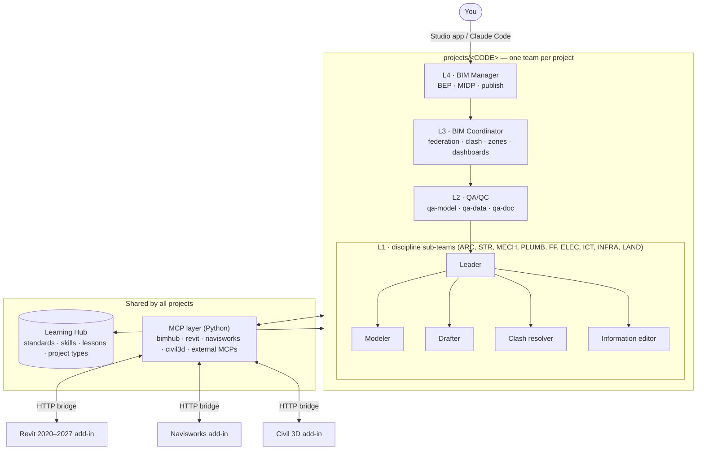

<div align="center">

# BIM Hub

**A multi-agent BIM department, run by Claude.**

ISO 19650 roles · CDE workflow · QA gates · Revit / Navisworks / Civil 3D through MCP · shared Learning Hub · 3D Studio app


</div>

---

BIM Hub turns Claude Code into a structured BIM team. Every project gets its own team of agents, organised the way a real BIM department works under ISO 19650:

- **Discipline sub-teams** do the work.
- **QA/QC** gates what they produce.
- **The BIM Coordinator** federates and clears zones.
- **The BIM Manager** owns the BEP and publishes.

All of them share:

- **One Learning Hub** of standards, skills and approved lessons. Every project learns from every other.
- **One MCP layer** that connects them to Revit, Navisworks and Civil 3D, with server-side permissions. For example, a drafter cannot edit a model, and nobody can draft in a zone the coordinator has not marked *coordinated*.

You can talk to any agent from Claude Code or from **BIM Hub Studio**, a desktop app with a live 3D view of the team.

> Built by **Eng. Mohamed Osama**, Head of BIM/GIS (Egypt).

---

## Contents

- [Architecture](#architecture)
- [Project types](#project-types)
- [The team](#the-team)
- [Features](#features)
- [Repository layout](#repository-layout)
- [Installation](#installation)
- [Quick start](#quick-start)
- [BIM Hub Studio](#bim-hub-studio)
- [Project files and sources](#project-files-and-sources)
- [MCP layer](#mcp-layer)
- [Revit add-in](#revit-add-in)
- [Learning Hub](#learning-hub)
- [Guardrails](#guardrails)
- [Development](#development)
- [Roadmap](#roadmap)

---

## Architecture



| Layer | Agents | Job |
|---|---|---|
| **L4 Management** | `bim-manager` | Information management, BEP, MIDP, authorises SHARED → PUBLISHED |
| **L3 Coordination** | `bim-coordinator` | Federation, clash matrix, issues, coordination zones, dashboards |
| **L2 QA/QC** | `qa-model` · `qa-data` · `qa-doc` | The WIP → SHARED gate: geometry and model health, information/LOIN/COBie, naming and documents |
| **L1 Disciplines** | `<disc>-leader` · `-modeler` · `-drafter` · `-clash` · `-info` | The work, one 5-role sub-team per discipline |
| **L0 Shared** | Learning Hub + MCP layer | Knowledge every agent reads; tools every agent uses |

---

## Project types

Each project is created with a **type**. The type defines its workflow stages, who owns each stage, which QA agent gates it, the roles it needs, its parameters and its skills. Agents read the generated `WORKFLOW.md` and move stages with the `stage_update` tool.

| Type | العربية | What it delivers | Stages |
|---|---|---|---|
| `cad-to-bim` | تحويل CAD إلى موديل Revit منسّق | Coordinated LOD 300 Revit models from 2D CAD/PDF, clash-free by zone, with optional sheets | CAD audit → setup → modelling → clash → information → sheets → issue |
| `model-review` | مراجعة موديلات Revit / IFC مقابل LOD 300 | A scored review report for received RVT/IFC models (geometry, information, integrity, coordination), with an A/B/C recommendation. Received models are never modified. | Register → criteria matrix → geometry → information → coordination → report → sign-off |
| `lod-uplift` | رفع الموديلات من LOD 300 إلى LOD 400 | Fabrication-level models: manufacturer families, connections, supports, rebar, spools, plus shop/spool drawings for approval | Baseline → LOD 400 matrix → detailing → fabrication coordination → fabrication data → shop drawings → approval |
| `scan-to-bim` | موديلات As-built من Point Cloud | As-built models from E57/RCP/LAS to a specified **USIBD LOA**, with a deviation analysis and an accuracy statement | Registration check → scope/LOA matrix → modelling → deviation QA → as-built data → drawings → handover |

```powershell
bimhub types                                                            # list types and stages
bimhub new-project REV1 --name "Tower review" --team arc,str,mech --type model-review
```

Stage rules are enforced by the server:

1. The status flow is `todo → in-progress → review → qa-pass / qa-fail → done`.
2. Only the stage's QA gate can pass or fail it.
3. Only the coordinator or manager can close it, and only after a pass.
4. A `qa-fail` automatically messages the owner.

Types are plain YAML in `learning-hub/project-types/`. Copy one to create your own.

---

## The team

Every discipline on a project gets a 5-role sub-team:

| Role | Responsibility |
|---|---|
| **Leader** | Plans the discipline's workflow with the QA/QC layer and receives issues and QA failures |
| **Modeler** | Builds the model from CAD or develops an LOD 300 model; the only role (with clash and info) that writes to the model |
| **Drafter** | Produces sheets, but only for zones the coordinator has released (`drafting_clearance`) |
| **Clash resolver** | Resolves clashes and exports NWC to the agreed path (`exports.nwc` in `project.yaml`) |
| **Information editor** | Fills project data and shared parameters, and submits model health against project requirements |

The coordinator turns Navisworks data and model-health reports into **dashboards**: clashes, project information, shared-parameter coverage and model health. Dashboards are published as self-contained HTML.

---

## Features

- **Hierarchical agents** generated per project from templates: core agents plus *disciplines × roles*.
- **Project types** with enforced workflow stages and QA gates.
- **Native MCP servers** in Python, about 80 tools in total:
  - `bimhub`: 32 tools. Hub search, project info, workflow, issues, decisions, messages, CDE model status, lessons, zones, health, dashboards, file sources, naming.
  - `revit`: 11 tools. Model info, elements, parameters, warnings, audit, views/sheets, selection, IFC and NWC export, parameter writes.
  - `navisworks`: 26 tools. Document info, search, properties, sets, clash tests and results, grouping and status, viewpoints.
  - `civil3d`: 10 tools. Alignments, profiles, surfaces, corridors, pipe networks and rules.
  - Plus **any external MCP** registered in `config/servers.yaml`.
- **Reads project files from local folders or ACC**, either through Autodesk Desktop Connector or through the browser with Claude in Chrome. Supported formats:
  - Read fully: IFC, DOCX, XLSX, PDF, PPTX, TXT/CSV/JSON/XML.
  - Header data read from the file itself: RVT, NWC/NWD/NWF, DWG, and point clouds (E57, LAS/LAZ, RCP/RCS, PTS).
- **ISO 19650 state** stored in plain files in `05-state/`: issues (event log), decisions, messages, CDE status, zones, health, workflow, and an activity log of every tool call.
- **Revit add-in** for every version from 2020 to 2027, from one C# project.
- **BIM Hub Studio**: React + three.js app with a live 3D team view, chat with any agent, workflow, issues, CDE, zones, health, dashboards and the Learning Hub. It runs in the browser or as a Tauri desktop installer.
- **Two Claude modes**: your own **Claude subscription** through Claude Code, or an **API key** stored in the Windows Credential Manager.

---

## Repository layout

```
BIM-Hub/
├─ agents/                    Agent templates (source of truth)
│  ├─ L4-management/  L3-coordination/  L2-qa/
│  └─ L1-disciplines/         disciplines.yaml + roles/{leader,modeler,drafter,clash,info}.md
├─ learning-hub/              Shared by ALL projects
│  ├─ knowledge/              00-standards (ISO 19650, naming, LOIN, LOD 2021, LOD 400, COBie, USIBD LOA) · 02-disciplines
│  ├─ skills/                 Claude Code skills (cad-to-bim, model-review-report, lod-uplift, scan-to-bim, clash-workflow, …)
│  ├─ project-types/          Workflow definitions (YAML)
│  └─ lessons/                Approved lessons learned
├─ mcp-layer/                 Python package `bimhub`
│  ├─ src/bimhub/             core · servers · state · files · knowledge · reports · cli · studio
│  ├─ config/                 servers.yaml (MCP registry) · hub.yaml · bridges/
│  └─ tests/                  pytest (incl. end-to-end MCP over stdio with fake Revit/Navisworks)
├─ addins/revit/              C# Revit bridge add-in (2020–2027)
├─ studio-ui/                 React + three.js UI and Tauri desktop shell
├─ projects/_template/        Skeleton copied for every new project
├─ install.ps1                One-command installer (Windows)
└─ bimhub.cmd                 CLI launcher
```

---

## Installation

**Requirements:** Windows 10/11, Python 3.10+, [Claude Code](https://docs.claude.com/en/docs/claude-code/overview). Optional: Revit, Navisworks, Civil 3D; Node 20+ and Rust to build the desktop installer; .NET SDK to build the Revit add-in.

```powershell
git clone https://github.com/Muhammad-208/BIM-Hub.git "E:\Ai\BIM Hub"
cd "E:\Ai\BIM Hub"
powershell -ExecutionPolicy Bypass -File .\install.ps1
```

`install.ps1` does the following:

1. Finds Python.
2. Creates `mcp-layer\.venv` and installs the package with extras: `ingest` for Office/PDF readers, `studio`, `dev`.
3. Runs the tests and `bimhub doctor`.
4. Syncs the projects.

The hub works from any folder. Set `BIMHUB_ROOT` if you run it from elsewhere.

---

## Quick start

```powershell
# 1. create a project (type + team)
.\bimhub.cmd new-project AOH --name "AOH Hospital" --team arc,str,mech,plumb,ff,elec,ict --type cad-to-bim

# 2. tell it where the files are (local, ACC Desktop Connector, or ACC web)
.\bimhub.cmd source add AOH --name ACC --type acc-dc --path "C:\Users\me\DC\ACCDocs\Account\AOH\Project Files"
.\bimhub.cmd scan AOH

# 3. talk to the team
.\bimhub.cmd studio                 # the app, http://localhost:8800
#   or in Claude Code:
cd projects\AOH ; claude
> @bim-manager  prepare the BEP outline from 00-inputs/EIR.pdf
> @mech-clash   group the L03 clashes and export NWC
> @qa-doc       check file names in 02-cde/WIP
```

| Command | Purpose |
|---|---|
| `bimhub new-project <CODE> --name … --team … [--type …]` | Create a project and its team |
| `bimhub types` | List project types |
| `bimhub sync [--project CODE]` | Regenerate agents, skills, `.mcp.json` and `WORKFLOW.md` after hub changes |
| `bimhub source list\|add\|remove <CODE>` | Manage file sources |
| `bimhub scan <CODE>` | Index all files in the sources |
| `bimhub list` · `bimhub doctor` | Projects · health check (MCPs, bridges, Claude) |
| `bimhub studio` | Start the Studio app |

---

## BIM Hub Studio

The Studio is the front end for the whole team. You type to any agent, and your message is sent to **Claude Code** running inside that project, as `claude -p --agent <name>` with the prompt passed on stdin. Each agent keeps its own session. Every MCP call from any session is streamed back over SSE and animated in the 3D view.

- **Projects:** create typed projects, add sources, scan and browse files.
- **Studio 3D:** the team in 3D. Tabs: Workflow, Activity, Issues, Messages, CDE, Zones, Health, Dashboards, Learning Hub (approve lessons).
- **Settings:**
  - Mode: *Claude subscription* (your `claude auth login`, personal use) or *API key* (pay per use; required for team or product use and unattended runs).
  - Model, permission mode, allowed tools, reply language (Egyptian Arabic or English).

To build the desktop installer (`.exe` / `.msi`):

```powershell
powershell -ExecutionPolicy Bypass -File .\studio-ui\build-desktop.ps1
```

---

## Project files and sources

Agents can read **only** inside a project's folder and its declared sources. They never modify a source.

| Source type | How it works |
|---|---|
| `local` | Any folder or network share |
| `acc-dc` | ACC / BIM 360 synced locally by Autodesk Desktop Connector |
| `acc-web` | ACC in the browser. Agents browse it with Claude in Chrome (skill `acc-browse`). Downloads need your approval. |

Each project folder follows the ISO 19650 CDE layout:

| Folder | Contents |
|---|---|
| `00-inputs/` | Received information |
| `01-bep/` | BEP, MIDP, TIDPs |
| `02-cde/` | `WIP/<DISC>`, `SHARED`, `PUBLISHED` |
| `03-coordination/` | Coordination work |
| `04-qa/` | QA reports |
| `05-state/` | Project state, written through MCP only |
| `06-reports/` | Reports and dashboards |
| `07-lessons-inbox/` | Proposed lessons |
| `team-notes/` | Per-agent project notes |

---

## MCP layer

`mcp-layer/config/servers.yaml` is the single registry of every MCP the agents may use:

```yaml
servers:
  bimhub:     {kind: native, module: bimhub.servers.hub}
  revit:      {kind: native, module: bimhub.servers.revit,      bridge: {url: "http://localhost:8766"}}
  navisworks: {kind: native, module: bimhub.servers.navisworks, bridge: {url: "http://localhost:8765", map: "bridges/navisworks.yaml"}}
  civil3d:    {kind: native, module: bimhub.servers.civil3d,    bridge: {url: "http://localhost:8767"}}
  my-tool:    {kind: external, command: "python", args: ["D:/MCP/my_tool/server.py"]}
```

Each project chooses its MCPs in `project.yaml → mcp:`, and `bimhub sync` writes that project's `.mcp.json`.

Native servers talk to the desktop apps over a small HTTP bridge protocol, documented in [`mcp-layer/BRIDGE_PROTOCOL.md`](mcp-layer/BRIDGE_PROTOCOL.md). To add an app, implement the bridge routes and add a thin adapter. See [`mcp-layer/README.md`](mcp-layer/README.md).

---

## Revit add-in

`addins/revit` is one C# project, multi-targeted to every Revit version:

| Revit | Target framework |
|---|---|
| 2020 | .NET Framework 4.7 |
| 2021–2024 | .NET Framework 4.8 |
| 2025–2026 | .NET 8 |
| 2027 | .NET 10 |

It runs an `HttpListener` on `localhost:8766` and executes commands on Revit's API thread through an `ExternalEvent`.

```powershell
cd addins\revit
dotnet build -c Release            # builds dist\2020 … dist\2027
powershell -ExecutionPolicy Bypass -File .\install.ps1
```

---

## Learning Hub

The hub is shared by every project, so a lesson learned on one job is available on the next. It contains:

- **Knowledge:** distilled standards, including:
  - ISO 19650-1/2, CDE status and revision codes, naming
  - Level of information need, BIMForum LOD Spec 2021, LOD 400 fabrication
  - COBie, USIBD LOA
- **Skills:** step-by-step procedures Claude Code loads on demand, including:
  - naming, CDE workflow, clash workflow, model QA, LOIN check, COBie validation, BEP authoring
  - lesson capture, ACC browsing, CAD to BIM, model review report, LOD uplift, scan to BIM
- **Lessons:**
  1. Any agent proposes a lesson with `lesson_propose`.
  2. You approve it in the Studio or with `lesson_approve`.
  3. `bimhub sync` delivers it to every project.

Standards summaries are the author's distillations for working use. Always check the current official edition for contractual work.

---

## Guardrails

Permissions are enforced **in the MCP servers**, not in prompts:

- **Write scopes.** Only a discipline's modeler, clash resolver or information editor can change that discipline's model. Only clash resolvers and modelers export NWC.
- **Layer rules.** Zones, dashboards and closing a stage need L3+. QA gates belong to the named QA agent.
- **Drafting gate.** Sheets are allowed only in zones marked *coordinated*.
- **Read-only sources.** Agents never write to ACC or source folders, and every download needs approval.
- **Audit trail.** Every tool call is logged with its agent, arguments and result.
- **Secrets.** The API key lives in the Windows Credential Manager, never in project files.

---

## Development

```powershell
.\mcp-layer\.venv\Scripts\python -m pytest mcp-layer\tests -q
```

The tests cover the CLI and state, roles, zones and dashboards, file readers, project types and workflow gates, and the Studio API (with a fake Claude Code). An end-to-end test runs the MCP servers over stdio against fake Revit and Navisworks bridges.

UI development:

```powershell
cd studio-ui ; npm install ; npm run dev       # proxies /api to bimhub studio on :8800
```

---

## Roadmap

- [ ] IFC 3D model viewer in the Studio
- [ ] Revit commands for views and sheets for the drafter role
- [ ] Navisworks route for shared-parameter coverage
- [ ] Deviation-analysis helper for scan-to-BIM (cloud-to-model)
- [ ] More discipline knowledge: Egyptian codes, company modelling standards, family standards

---

<div align="center">

**نظرة سريعة بالعربي**

BIM Hub بيحوّل Claude Code لقسم BIM كامل:
- فريق لكل مشروع: BIM Manager، وCoordinator، وثلاثة agents للـ QA/QC، وفريق من 5 أدوار لكل تخصص.
- مكتبة معرفة مشتركة بين كل المشاريع.
- طبقة MCP بتوصل لـ Revit وNavisworks وCivil 3D.
- أنواع مشاريع جاهزة، كل نوع ليه مراحل وبوابات QA: CAD لـ BIM، مراجعة موديلات، رفع LOD 300 لـ 400، وAs-built من Point Cloud.

</div>
